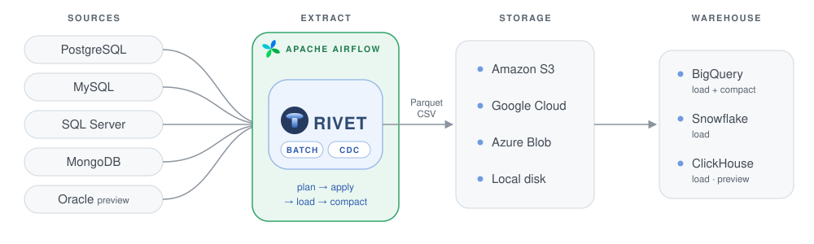

# airflow-provider-rivet

<p align="center">
  <picture>
    <source media="(prefers-color-scheme: dark)" srcset="docs/assets/provider-flow-dark.svg">
    
  </picture>
</p>

<p align="center">
  <a href="https://github.com/panchenkoai/airflow-provider-rivet/blob/main/airflow_provider_rivet/__init__.py"></a>
  <a href="https://github.com/panchenkoai/airflow-provider-rivet/blob/main/pyproject.toml"></a>
  <a href="https://github.com/panchenkoai/airflow-provider-rivet/blob/main/pyproject.toml"></a>
  <a href="https://github.com/panchenkoai/airflow-provider-rivet/actions/workflows/ci.yml?query=branch%3Amain"></a>
  <a href="https://github.com/panchenkoai/airflow-provider-rivet/blob/main/LICENSE"></a>
</p>

Apache Airflow operators and DAG builders that run the [rivet](https://github.com/panchenkoai/rivet)
binary on the worker as a subprocess and turn its result into Airflow's: retry or stop, which
unit failed, and what to do about it. The contract it implements is
[ADR-0039](https://github.com/panchenkoai/rivet/blob/main/docs/adr/0039-scheduler-contract.md).

rivet itself (sources, destinations, warehouses, CDC, configs): **<https://github.com/panchenkoai/rivet>**.

## How it works

- **A task runs the rivet binary on the worker**, as a subprocess with a minimal environment; no
  rivet code runs inside Airflow.
- **Plan, then apply.** `RivetApplyOperator` seals a plan (`rivet plan`) and applies it
  (`rivet apply`); a retry replays the same sealed plan, a cleared task plans again. `load` and
  `compact` tasks follow per table.
- **rivet's exit becomes Airflow's decision**: success, a retry for what may pass by itself, a
  final stop for a refusal. The code, class and action go to XCom and to a short block in the
  task log; rivet's raw output stays in files.
- **DAG builders** make the whole batch DAG (plan, apply, load, compact, in waves) or the CDC DAG
  (one bounded drain, then load and compact per table) from a config.
- **State** lives in a declared directory on the worker (`state_dir`, SQLite) or in PostgreSQL
  (`RIVET_STATE_URL`); the operator refuses a missing or mismatched one instead of starting from
  empty state.
- **Credentials come from Airflow Connections** (databases, storage, warehouses), resolved inside
  the task; nothing secret is in argv, XCom or the task log.

Status: alpha. It is versioned independently of the binary and checks
the binary's version at run time (minimum **rivet 0.31.0**; a lower one is refused with both
versions in the message). Supported: Airflow 2.10+ and 3.x, Python 3.12+ (Airflow 2.10 only on 3.12).

## Install

```bash
pip install airflow-provider-rivet            # or airflow-provider-rivet[slack]
```

Install it into the Airflow environment with Airflow's own constraints file, so it does not move
Airflow's pins.

The rivet binary must be on every worker. On the official Airflow images (Debian 12, glibc 2.36)
take it from rivet's container image, which is built on the same Debian release; the
`*-linux-gnu` archive of rivet 0.31.0 needs glibc 2.38 and does not start there:

```dockerfile
FROM apache/airflow:3.3.2
COPY --from=ghcr.io/panchenkoai/rivet:v0.31.0 /usr/local/bin/rivet /usr/local/bin/rivet
RUN pip install --no-cache-dir airflow-provider-rivet
```

The rivet binary must be on the worker's `PATH`, or pass `rivet_bin="/abs/path/rivet"`.

## Example

```python
from airflow_provider_rivet.dags import build_batch_dag

dag = build_batch_dag(
    "rivet_postgres",
    config="/opt/pipelines/postgres.yaml",
    state_dir="/var/lib/rivet/postgres",
    exports=["users", "orders"],
    operator_kwargs={"env_from_connections": {"RIVET_PG_URL": "rivet_postgres"}},
)
```

## Documentation

| Topic | |
|---|---|
| [Operators](https://github.com/panchenkoai/airflow-provider-rivet/blob/main/docs/operators.md) | each operator, its parameters, the XCom value, reading the task log |
| [DAG builders](https://github.com/panchenkoai/airflow-provider-rivet/blob/main/docs/dag-builders.md) | `build_batch_dag`, `build_cdc_dag`: tasks, waves, trigger rules, the `watcher` |
| [Retries](https://github.com/panchenkoai/airflow-provider-rivet/blob/main/docs/retries.md) | exit status → success, retry or stop; the crashed budget; a retry of an apply that succeeded |
| [State](https://github.com/panchenkoai/airflow-provider-rivet/blob/main/docs/state.md) | state by deployment, the local worker setup guide, moving to PostgreSQL |
| [Connections and secrets](https://github.com/panchenkoai/airflow-provider-rivet/blob/main/docs/connections-and-secrets.md) | the subprocess environment, database / storage / warehouse Connections, where to keep them |
| [Slack alerts](https://github.com/panchenkoai/airflow-provider-rivet/blob/main/docs/slack.md) | the failure callback and its setup guide |
| [Capabilities](https://github.com/panchenkoai/airflow-provider-rivet/blob/main/docs/capabilities.md) | what works with today's rivet and what waits for a newer one |
| [Overlap and known limits](https://github.com/panchenkoai/airflow-provider-rivet/blob/main/docs/limits.md) | locks between runs of one export; what the package cannot see |
| [Development](https://github.com/panchenkoai/airflow-provider-rivet/blob/main/docs/development.md) | tests, mutation testing, the live gate |
| [Changelog](https://github.com/panchenkoai/airflow-provider-rivet/blob/main/CHANGELOG.md) | |
